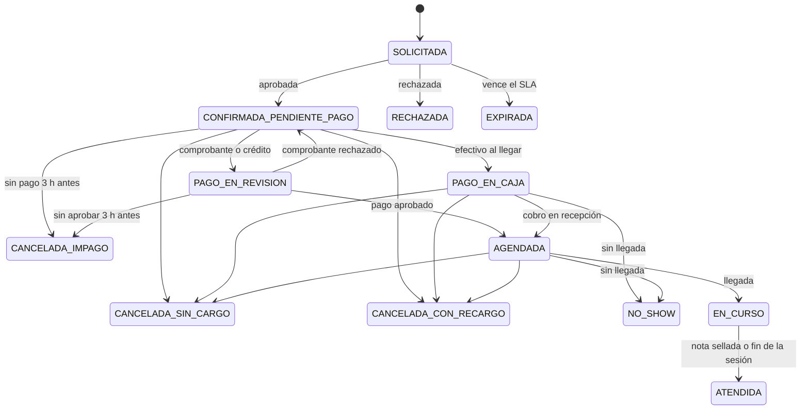

# BPMS · Clínica de psicología

Sistema de gestión de procesos para una clínica de psicología de una sola profesional:
agendamiento en línea con aprobación por SLA, pagos con conciliación humana, cancelación y
reprogramación con política escalonada y crédito a favor, expediente clínico con nota SOAP
inmutable, bitácora de accesos, tablero de indicadores con exportación a Excel y PDF, y un
asistente conversacional que responde con fuente, agenda y escala las crisis.

Laravel 13 · Filament 5 · Livewire 4 · MariaDB 11.4 · Redis 7 · MinIO (S3) · Mailpit, y el
asistente en Python 3.13 con FastAPI y Claude Haiku 5.5.
Este README resume los cuatro manuales de [`docs/manuales/`](docs/manuales/), que tienen el
detalle, las capturas y los diagramas.

| Dato | Valor |
|---|---|
| Producción | https://pf-clinica.duckdns.org (panel `/admin`, portal `/portal`) |
| Pruebas | stage en el puerto 8081 y dev en el 8082 del mismo dominio |
| Nube | AWS `us-east-1`, creada con Terraform; unos USD 50 al mes |

| Perfil | Rol | Entra por | Hace |
|---|---|---|---|
| Psicóloga | Administradora (`admin`) | `/admin`, con segundo factor obligatorio | Atiende, documenta, asigna pruebas, lee reportes y configura la clínica |
| Recepción | Personal (`secretary`) | `/admin`, con segundo factor obligatorio | Aprueba solicitudes, concilia pagos, agenda por teléfono, da de alta pacientes y registra llegadas |
| Paciente | Usuario (`patient`) | Landing y `/portal` | Agenda, paga, cancela o reprograma y responde las pruebas asignadas |

## Levantar el proyecto

Requiere Docker. Cinco comandos:

```bash
cp .env.example .env
docker compose up -d
docker compose exec app composer install
docker compose exec app php artisan key:generate && echo "CLINICAL_ENCRYPTION_KEY=base64:$(head -c 32 /dev/urandom | base64)" >> .env
docker compose up -d --force-recreate app worker scheduler && docker compose exec app php artisan migrate --seed
```

La llave `CLINICAL_ENCRYPTION_KEY` cifra las notas SOAP y es distinta de `APP_KEY`. Sin ella,
el expediente no abre. El último comando recrea los contenedores para que la lean.

| Superficie | URL |
|---|---|
| Landing y agendamiento | http://localhost |
| Portal del paciente | http://localhost/portal |
| Panel (psicóloga y recepción) | http://localhost/admin |
| Correo capturado (Mailpit) | http://localhost:8025 |
| Consola de MinIO | http://localhost:9001 |

El asistente (`chatbot/`) no publica puertos: el widget de la landing le habla desde Laravel. Sin
`ANTHROPIC_API_KEY` en el `.env`, el widget no ofrece chat. En su lugar muestra las preguntas
frecuentes, el enlace para agendar, el teléfono y la línea de crisis (ADR-038). En local, el token
entre Laravel y el asistente tiene un valor de serie.

### Cuentas de demostración

Solo con `APP_ENV=local`. La contraseña de las tres es `password`. El personal configura su
segundo factor la primera vez que entra al panel; el código por correo llega a Mailpit.

| Perfil | Correo |
|---|---|
| Psicóloga (administradora) | `psicologa@clinica.test` |
| Recepción | `recepcion@clinica.test` |
| Paciente | `paciente@clinica.test` |

## Verificar

```bash
docker compose exec app vendor/bin/pint --test
docker compose exec app vendor/bin/phpstan analyse --memory-limit=1G
docker compose exec app vendor/bin/deptrac analyse --fail-on-uncovered
docker compose exec app vendor/bin/pest
docker compose exec -e CACHE_STORE=null app vendor/bin/pest --testsuite=Feature   # CA-32
```

`vendor/bin/pest --testsuite=Unit` prueba el dominio sin base de datos ni framework: son las
reglas RN-xx y la máquina de 13 estados de la cita.

El asistente se verifica como en la CI, dentro de su imagen de Python y sin dejar archivos en el
repositorio. `pytest` incluye la batería de 20 casos de crisis:

```bash
docker run --rm -v "$PWD/chatbot:/src:ro" python:3.13.16-slim-trixie sh -c 'cp -r /src /tmp/chatbot && cd /tmp/chatbot \
  && pip install -q --root-user-action=ignore --disable-pip-version-check -r requirements-dev.txt \
  && ruff format --check . && ruff check . && mypy app tests && pytest && pip-audit -r requirements.txt'
```

## Arquitectura

Monolito modular en Laravel más un servicio aparte en Python para el asistente: el backend
heterogéneo. Laravel atiende la landing, el portal, el panel y una API interna; el asistente
consulta esa API y nunca la base de datos (ADR-012).

| Interfaz | Ruta | Tecnología | Quién la usa |
|---|---|---|---|
| Landing | `/` | Livewire y Alpine | Público: servicios, preguntas frecuentes, agendamiento y asistente |
| Agendamiento | `/agendar` | Livewire (`BookingWizard`) | Pacientes nuevos o recurrentes |
| Portal | `/portal` | Panel `portal` de Filament | Pacientes: citas, pagos, pruebas y perfil |
| Panel | `/admin` | Panel `admin` de Filament | Recepción y psicóloga |
| API del asistente | `/api/v1` | Laravel con token de servicio; OpenAPI 3.1 en [`docs/api/openapi.yaml`](docs/api/openapi.yaml) | Solo el contenedor del asistente |
| Salud | `/up` | Laravel | El pipeline y el chequeo de salud de nginx |

| Método y ruta | Qué hace |
|---|---|
| `GET /api/v1/knowledge` | Base de conocimiento: preguntas frecuentes, servicios y tarifas vigentes |
| `GET /api/v1/availability` | Horarios libres de un servicio en un día, con las reglas de anticipación aplicadas |
| `POST /api/v1/appointments` | Solicita una cita con origen `chat`, con las mismas reglas que la landing |
| `POST /api/v1/crisis-alerts` | Alerta urgente a la psicóloga (NT-24), sin datos de la persona |

### Dominio hexagonal

El dominio no conoce Laravel: vive en `src/<Contexto>/Domain/` y no importa `Illuminate\*`.
Laravel, Filament y la base de datos son adaptadores. Deptrac (`--fail-on-uncovered`) rompe la
construcción ante una dependencia al revés.

| Contexto | Responsabilidad | Piezas principales |
|---|---|---|
| `Scheduling` | Disponibilidad, pre-citas, aprobación y SLA, cancelación, reprogramación, inasistencia y bloqueos | Agregado `Appointment`, `BookingService`, `AppointmentTransitions`, `TieredCancellationPolicy`, `AvailabilityCalculator` |
| `Billing` | Pagos, comprobantes, conciliación, cargos y crédito a favor | `Payment`, `CreditAllocation`, `BillingService`; puertos `FiscalDocumentIssuer` y `PaymentGateway` |
| `ClinicalRecords` | Expediente, notas SOAP cifradas e inmutables, pruebas PHQ-9 y GAD-7 | `ClinicalNote`, `PsychTest`, `PsychTestAssignment`, `PsychTestService`, `ClinicalCipher` |
| `Identity` | Pacientes y su registro | `PatientRegistry`; usuarios, roles y segundo factor los resuelven Filament y `app/Policies` |
| `Notifications` | Plantillas, canales, preferencias, ventana de silencio, idempotencia y reintentos | `NotificationDispatcher`, `SendNotificationJob`, `MailChannel`, `WhatsAppChannel` |
| `Analytics` | Los 13 indicadores y los reportes; solo lee | `ReportService`, `ReportPeriod`, `Report`, `Kpi` |
| `Shared` | Reloj, bus de eventos, reglas de negocio y objetos de valor | `ClockInterface`, `EventBus`, `BusinessRules`, `Money` |
| Asistente (`chatbot/`) | Conversación, agendamiento por la API y crisis | `crisis.py` (clasificador determinista), `assistant.py`, `laravel.py` |

Los contextos se comunican solo por eventos de dominio, sin uniones SQL entre ellos:

| Emisor | Eventos |
|---|---|
| `Scheduling` | `PreAppointmentRequested`, `AppointmentApproved`, `AppointmentRejected`, `PreAppointmentExpired`, `PayAtDeskChosen`, `AppointmentFullyBooked`, `AppointmentCheckedIn`, `AppointmentCancelled`, `AppointmentCancelledUnpaid`, `AppointmentNoShow`, `ReminderDue` |
| `Billing` | `PaymentProofSubmitted`, `PaymentApproved`, `PaymentRejected`, `PaymentSettledByCredit`, `LateCancellationFeeApplied`, `LateCancellationFeeWaived`, `PatientCreditIssued` |
| `ClinicalRecords` | `ClinicalNoteSealed`, `PsychTestAssigned`, `PsychTestSubmitted`, `PsychTestOverdue` |
| `Identity` | `PatientAccountCreated` |

`SchedulingEventSubscriber` programa los trabajos diferidos (expiración, impago y recordatorios)
y responde a los pagos y a la nota sellada; `BillingEventSubscriber` abre o liquida el cobro;
`DomainEventNotifier` convierte cada evento en su aviso.

Cada puerto se une a su adaptador en `AppServiceProvider`: cambiar un adaptador es una línea.

| Puerto | Adaptador actual | Alternativa prevista |
|---|---|---|
| `AppointmentRepository`, `AvailabilityProvider`, `ServiceCatalog`, `PatientRegistry`, `PaymentRepository`, `ClinicalNoteRepository`, `PsychTestAssignmentRepository` | `Database…` sobre MariaDB; los clínicos cifran con `ClinicalCipher` | — |
| `SlotLockManager` | Candado de caché, con el índice único `(therapist_id, starts_at, active_slot)` como red de seguridad | Bloqueo pesimista |
| `FiscalDocumentIssuer` · `PaymentGateway` | `NullFiscalDocumentIssuer` · `NullPaymentGateway` | Certificador FEL · pasarela de tarjeta |
| `NotificationChannel` | `MailChannel` y, si se configura, `WhatsAppChannel` | SMS |
| `MetricsSource` | `DatabaseMetricsSource` | Tablas resumen (M-04) |
| `ReportExporter` | `ReportFileExporter` (openspout y dompdf) | — |
| `ClockInterface` | `SystemClock` (`FrozenClock` en pruebas) | — |
| `EventBus` | `LaravelEventBus` | Un broker de mensajes |
| `BusinessRules` | `BusinessRuleSettings`: RN-01 a RN-20 en la base, con vigencia | — |

### Estructura

```
src/<Contexto>/Domain          reglas de negocio, sin Illuminate\* (Deptrac lo verifica)
src/<Contexto>/Application     orquestación de los casos de uso
src/<Contexto>/Infrastructure  adaptadores: base de datos, colas, correo, candados
app/                           Laravel: Filament (panel y portal), Livewire (landing y widget), API,
                               modelos de lectura, políticas y listeners
database/                      18 migraciones y semillas (catálogos, reglas, permisos, plantillas)
chatbot/                       el asistente: FastAPI, clasificador de crisis y cliente de la API
docker/                        Dockerfile con destinos dev, prod y web; configuración de nginx
infra/                         Terraform de AWS y su bootstrap
scripts/                       deploy.sh y tls.sh, que corren en la EC2
.github/workflows/             ci-cd.yml (calidad y despliegue) e infra.yml (Terraform con aprobación)
tests/                         Unit (dominio sin base), Integration y Feature
docs/                          manuales, contrato OpenAPI, decisiones, runbook y fase 2
```

## Seguridad

| Capa | Cómo se protege |
|---|---|
| Contraseñas | bcrypt; al menos 12 caracteres y no filtradas en brechas conocidas. La temporal vence en 72 horas y obliga a cambiarla |
| Segundo factor | Código de 6 dígitos por correo (vence en 10 minutos) o aplicación TOTP con 8 códigos de recuperación. Obligatorio para el personal, opcional para pacientes |
| Recuperación | Enlace firmado de un solo uso que vence en 60 minutos, una solicitud por minuto. Responde igual exista o no la cuenta; al cambiar la contraseña cierra las demás sesiones |
| Sesiones | En la base, con cookies `secure`, `httponly` y `samesite`, regeneradas al ingresar. Vencen tras 2 horas sin actividad en el portal y 8 en el panel. 5 intentos de ingreso por minuto |
| Autorización | 32 habilidades por rol y políticas por recurso. Cada perfil entra solo por su panel (en el otro, el ingreso rechaza credenciales correctas) y el paciente solo ve lo suyo |
| Datos clínicos | Notas SOAP y respuestas de pruebas cifradas por la aplicación con `CLINICAL_ENCRYPTION_KEY`, distinta de `APP_KEY`. Triggers impiden cambiar lo sellado o respondido y borrar cualquier registro clínico |
| Bitácora | `audit_log` sin `UPDATE` ni `DELETE` posibles: cada lectura del expediente y de un resultado, cada intento denegado y cada código de segundo factor equivocado |
| Archivos | Comprobantes y fotos en S3 privado, servidos por la aplicación con permiso: 404 a quien no puede verlos. El comprobante se valida como PDF por su contenido |
| Transporte | HTTPS con HSTS y cabeceras de seguridad, redirección de HTTP, sin contenido mixto y TLS obligatorio hacia RDS |
| Reposo y plataforma | Discos de la EC2 y de RDS cifrados, buckets privados y versionados, contenedores sin root, IMDSv2 obligatorio y tres roles IAM de mínimo privilegio; sin usar la cuenta raíz |
| Secretos | Environments de GitHub, escritos en el `.env` de la EC2 por el pipeline, que falla si falta un valor. Ninguno en el repositorio; gitleaks revisa cada Pull Request |
| Asistente | Ningún dato de pacientes llega al modelo. Un clasificador determinista detecta la crisis antes del modelo, con una batería de 20 casos en la CI |

| Área | Habilidades | Psicóloga | Recepción | Paciente |
|---|---|:-:|:-:|:-:|
| Citas de todos | Ver, crear, aprobar, rechazar, cancelar, registrar llegada e inasistencia | ✓ | ✓ | — |
| Citas propias | Ver, solicitar y cancelar | ✓ | ✓ | ✓ |
| Agenda | Bloquear horarios | ✓ | — | — |
| Pagos de todos | Ver, registrar y aprobar | ✓ | ✓ | — |
| Pagos propios | Ver y registrar | ✓ | ✓ | ✓ |
| Cargos | Exonerar un cargo por cancelación | ✓ | — | — |
| Pacientes | Ver, crear y editar la ficha y el motivo de consulta | ✓ | ✓ | — |
| Expediente clínico | Ver, crear, sellar y enmendar notas; asignar pruebas | ✓ | — | — |
| Pruebas | Responder las asignadas | — | — | ✓ |
| Personal | Crear usuarios y roles | ✓ | — | — |
| Reportes | Operativos · con ingresos | ✓ · ✓ | ✓ · — | — |
| Configuración | Reglas, servicios, preguntas frecuentes y bitácora | ✓ | — | — |

La administradora puede crear roles del personal con las habilidades que elija, salvo las
clínicas, que siguen siendo exclusivas de la psicóloga.

## Integraciones

| Integración | Cómo | Estado |
|---|---|---|
| Correo | SMTP de Gmail (587) con contraseña de aplicación, por la cola `mail` | Activo: segundo factor, recuperación y avisos |
| Almacenamiento | Amazon S3 con el rol IAM de la instancia | Activo: comprobantes y fotos de perfil |
| Asistente | Contenedor FastAPI que habla con Laravel por `/api/v1` con token | Desplegado; se activa con `ANTHROPIC_API_KEY` |
| WhatsApp | `WhatsAppChannel` con una plantilla aprobada por Meta | Listo; se activa con `WHATSAPP_TOKEN` y `WHATSAPP_PHONE_NUMBER_ID` |
| Facturación FEL y pasarela de tarjeta | Puertos con adaptador nulo | Listos para un adaptador cuando haya contrato |
| Certificados | Let's Encrypt por DNS en DuckDNS, con `lego`; el cron renueva a diario a las 04:17 | Activo |

## Reglas de negocio

Son parámetros en `business_rule_settings` con fecha de vigencia: se cambian desde el panel
(«Plazos y políticas») sin desplegar y aplican a las citas nuevas.

| Regla | Qué exige | Parámetro y valor |
|---|---|---|
| RN-01 | Sin agendamiento en línea para el mismo día; se ofrece el teléfono | `same_day_booking_enabled` = no |
| RN-02 | Anticipación mínima para agendar en línea | 24 h |
| RN-03 | La pre-cita se resuelve dentro del SLA o expira | 24 h hábiles, 72 h en fin de semana |
| RN-04 | El horario queda apartado durante el SLA | Derivado de RN-03 |
| RN-05 | El pago debe estar aprobado antes de la sesión | 3 h antes |
| RN-06 | Cancelación escalonada | 24 h o más: sin cargo; de 24 a 1 h: 50 %; menos de 1 h o no asistir: 100 % |
| RN-07 | Una cita solo queda agendada con el pago aprobado o cobrado | — |
| RN-08 | Recordatorios automáticos | 24 h y 2 h antes |
| RN-09 | Todo pago lo aprueba una persona | Aprobación automática = no |
| RN-10 | Solo la psicóloga edita el contenido clínico | — |
| RN-11 | Una nota sellada no cambia; la corrección es una versión nueva | — |
| RN-12 | Todo acceso al expediente queda en la bitácora | — |
| RN-13 | Cada paciente ve solo sus datos | — |
| RN-14 | Una boleta no se repite dentro del mismo banco | — |
| RN-15 | Contraseña temporal y código de segundo factor con vencimiento | 72 h y 10 min |
| RN-16 | La cancelación sin cargo de una cita pagada deja crédito a favor | Crédito, no reembolso |
| RN-17 | Avisos idempotentes y con ventana de silencio | 21:00 a 07:00, salvo urgentes |
| RN-18 | Bloquear la agenda obliga a resolver cada cita afectada | — |
| RN-19 | El asistente no toca la base: usa la API con permisos acotados | — |
| RN-20 | Ante señales de crisis: línea de emergencia, alerta y cierre de la conversación | Activo |

El agendamiento por teléfono o en recepción es la excepción a RN-01: permite el mismo día.

## Máquina de estados de la cita

Ninguna cita cambia de estado fuera de este diagrama: 13 estados y 20 transiciones, definidos en
`AppointmentStatus`. Toda cita nace `SOLICITADA`; la que agenda el personal se aprueba al crearla.



Liberan el horario `RECHAZADA`, `EXPIRADA` y las tres cancelaciones; `NO_SHOW` no, porque la
hora ya se consumió. `appointments:reconcile` corre cada 5 minutos: aplica los vencimientos y los
impagos, y cierra las sesiones terminadas (`EN_CURSO` → `ATENDIDA`; sin llegada → `NO_SHOW`) con
`changed_by` nulo, que es el sistema.

| Código | En el panel | En el portal |
|---|---|---|
| `SOLICITADA` | Solicitada | En revisión |
| `CONFIRMADA_PENDIENTE_PAGO` | Confirmada, pendiente de pago | Pago pendiente |
| `PAGO_EN_REVISION` | Pago en revisión | Revisando tu pago |
| `PAGO_EN_CAJA` | Pago en caja | Pagas al llegar |
| `AGENDADA` | Agendada | Confirmada |
| `EN_CURSO` | En curso | En sesión |
| `ATENDIDA` | Atendida | Atendida |
| `RECHAZADA` | Rechazada | No confirmada |
| `EXPIRADA` | Expirada | Venció sin respuesta |
| `CANCELADA_IMPAGO` · `_SIN_CARGO` · `_CON_RECARGO` | Cancelada por impago, sin cargo o con recargo | Cancelada |
| `NO_SHOW` | No se presentó | No asististe |

## Avisos

`NotificationDispatcher` toma los canales de las preferencias del paciente (correo y, si está
activo, WhatsApp). Una `idempotency_key` por evento, destinatario y canal impide repetir un aviso.
`SendNotificationJob` hace 3 intentos con espera creciente; al agotarlos sale NT-20. Entre las
21:00 y las 07:00 los avisos esperan (RN-17), salvo NT-20, NT-24 y NT-25, el código de inicio de
sesión y la recuperación de contraseña, que envía Filament fuera de las plantillas.

| Destinatario | Plantillas (`notification_templates`) |
|---|---|
| Paciente | NT-01 solicitud recibida · NT-02 acceso al portal · NT-04 aprobada, registra tu pago · NT-05 rechazada · NT-06 vencida · NT-08 confirmada · NT-09 comprobante rechazado · NT-10 cancelada por falta de pago · NT-11 y NT-12 recordatorios a 24 h y 2 h · NT-13 cancelada · NT-14 cargo por cancelación tardía · NT-15 sesión registrada · NT-16 cuestionario asignado · NT-22 cancelada por indisponibilidad · NT-23 crédito a favor |
| Recepción | NT-03 solicitud por aprobar · NT-07 comprobante por conciliar |
| Psicóloga | NT-17 cuestionario vencido, también al paciente · NT-24 posible crisis en el asistente · NT-25 ítem 9 del PHQ-9 mayor que cero |
| Administración | NT-20 un aviso falló tres veces |

## Reportes e indicadores

El tablero calcula 13 indicadores al vuelo para el periodo (este mes, mes anterior, últimos 90
días, este año o un rango de hasta un año) y el servicio elegidos. Los widgets y las dos
exportaciones salen del mismo cálculo, así que los totales no pueden diferir. «Exportar Excel»
(openspout) genera un `.xlsx` con las hojas Indicadores, Ingreso por servicio y Ocupación por día;
«Exportar PDF» (dompdf), el mismo reporte. Recepción lo recibe sin ninguna cifra de ingresos.

| Indicador | Cálculo | Meta |
|---|---|---|
| KPI-01 Inasistencia | Inasistencias entre las citas que llegaron a agendarse | ≤ 8 % |
| KPI-02 Tiempo de aprobación | Promedio entre la solicitud y la aprobación, solo en línea | ≤ 6 h |
| KPI-03 Solicitudes expiradas | Expiradas entre las solicitudes en línea del periodo | ≤ 5 % |
| KPI-04 Conversión de la landing | Sin dato: no se miden visitantes | Línea base + 20 % |
| KPI-05 Tiempo de conciliación | Promedio entre el comprobante subido y su aprobación | ≤ 4 h |
| KPI-06 Ocupación de agenda | Horarios ocupados entre horarios publicados, menos los bloqueos | ≥ 70 % |
| KPI-07 Ingreso cobrado | Pagos aprobados por transferencia o efectivo, por fecha de aprobación | — |
| KPI-08 Cancelación tardía | Cancelaciones con recargo entre las citas aprobadas | ≤ 10 % |
| KPI-09 Adherencia | Sesiones atendidas entre las que llegaron a agendarse | ≥ 75 % |
| KPI-10 Entrega de notificaciones | Enviadas entre enviadas y fallidas | ≥ 97 % |
| KPI-11 Sin intervención humana | Citas solicitadas por la web o el asistente entre todas | ≥ 70 % |
| KPI-12 Notas en 24 horas | Notas selladas a tiempo entre las sesiones cuyo plazo venció | ≥ 95 % |
| KPI-13 Ocupación sobre capacidad | Sesiones atendidas entre la capacidad nominal de los días transcurridos | ≥ 60 % |

## Modelo de datos

- Claves primarias UUID v7 (`CHAR(36)`) en las entidades de dominio; `BIGINT` autoincremental en
  catálogos y bitácoras.
- Dinero en `INT` de centavos más el código de moneda, nunca `FLOAT`. Fechas `DATETIME` en UTC; la
  hora de Guatemala solo al presentar.
- Claves foráneas `ON DELETE RESTRICT`: nada clínico ni financiero se borra en cascada.
- Sin `tenant_id`: hay una sola clínica (ADR-007). `utf8mb4_unicode_ci` en toda tabla.
- Cada tabla pertenece a un contexto y no hay uniones SQL entre contextos; los reportes leen cada
  contexto por separado.

| Área | Tablas | Claves y defensas |
|---|---|---|
| Identidad y acceso | `users` (rol, contraseña con hash, credencial temporal, segundo factor cifrado, foto, `is_active`), `roles`, `abilities`, `role_ability`, `patients` (documento, sexo, nacimiento, contacto de emergencia, NIT), `therapists`, `consents` (documento, versión, fecha e IP) | `email` único; un usuario nunca se borra, se desactiva. `(document_type_id, document_number)` único. El id del paciente y de la psicóloga es el de su usuario; `therapists` tiene una sola fila |
| Agenda | `services`, `service_prices`, `availability_rules`, `schedule_blocks`, `appointments` (estado, horario, tarifa congelada, origen `web`, `chat`, `phone` o `walk_in`, plazos de apartado y de pago, cita de origen si se reprogramó), `appointment_status_log` | `(service_id, effective_from)` único. `(therapist_id, starts_at, active_slot)` único impide la doble reserva: `active_slot` vale 1 mientras la cita ocupa el horario. El log solo inserta |
| Cobros | `payments` (sesión o cargo: método, estado, monto, porcentaje, revisión y exoneración), `payment_proofs` (boleta, banco, últimos 4 dígitos, fecha, PDF en S3 y su huella), `patient_credits` | `(origin_bank_id, receipt_number)` único. El crédito se consume del más antiguo al más nuevo |
| Expediente | `clinical_records` (motivo de consulta y quién refiere; recepción la ve), `clinical_notes` (SOAP cifrada en cuatro columnas, versión, enmienda y sellado), `psych_test_assignments` (instrumento, límite y respuestas cifradas; el resultado se calcula) | `patient_id` único; `(appointment_id, version)` único. Triggers: lo sellado o respondido no cambia y nada se borra |
| Avisos y transversales | `notification_templates`, `notification_dispatches` (canal, estado, intentos, hora programada y último error), `notification_preferences`, `business_rule_settings`, `audit_log`, `faqs` | `idempotency_key` único; `(user_id, channel_id)` único; las reglas guardan su historial con la clave `(rule_code, param_key, effective_from)`. `audit_log` sin `UPDATE` ni `DELETE` por trigger |
| Catálogos (12) | Roles, habilidades, estados de cita y de pago, métodos, bancos, canales, estados de aviso, motivos de cancelación, categorías, sexos y tipos de documento | `code` único; la semilla los reescribe en cada despliegue |
| Del framework | `sessions`, `jobs`, `job_batches`, `failed_jobs`, `cache`, `cache_locks`, `password_reset_tokens` | Sesiones y colas en la base (ADR-008) |

Las 18 migraciones corren solas en cada despliegue (`migrate --force`) y siempre hacia adelante: 3
del framework, 9 de la fase 2 (`2026_09_12_*` y `2026_09_18_*`) y 6 de la fase 3 (`2026_10_19_*`
a `2026_10_25_*`: segundo factor por aplicación, preguntas frecuentes, cita de origen, canales
elegidos, pruebas psicométricas y foto de perfil).

| Diseño | Construido | Por qué |
|---|---|---|
| Tabla `slot_holds` | El apartado vive en la cita (`active_slot` y `hold_expires_at`) | Un índice único sobre la cita basta |
| Tabla `two_factor_codes` | No existe | El código se guarda con hash en la sesión |
| Tabla `reminders` | No existe | Los recordatorios son trabajos diferidos con llave de idempotencia |
| Tres tablas de pruebas | Una sola, `psych_test_assignments` | Los instrumentos son un enum del dominio y el resultado se calcula |
| Tablas de conversaciones | No existen | El asistente no guarda conversaciones |
| Tablas resumen | No existen | Reportes al vuelo, suficientes a este volumen (ADR-032) |
| Pago en caja → solo cancelación | También pago en caja → inasistencia | La sesión sin llegada se cierra sola (ADR-039) |

## Uso por perfil

En el panel, el menú muestra solo lo que el rol puede usar y las acciones de cada fila están en su
menú ⋮.

**Paciente**

| Tarea | Dónde | Reglas |
|---|---|---|
| Agendar | Landing → «Agendar una cita»: servicio → día y hora → datos (NIT o `CF`) y aceptación de la política → solicitud recibida | La cuenta se crea al confirmar y la contraseña temporal llega por correo (NT-02). Solo horarios a 24 h o más; para hoy, el teléfono. Si otro toma el horario, ofrece los tres libres más cercanos sin perder los datos |
| Pagar | Mis citas → «Registrar mi pago» (boleta, banco, últimos 4 dígitos, fecha y PDF de hasta 5 MB), o ⋮ → «Pagar en efectivo al llegar» | Aprobado 3 h antes o la cita se cancela; en efectivo esa regla no aplica. El crédito a favor se aplica primero |
| Cancelar o reprogramar | Mis citas → ⋮, hasta la hora de inicio, con el cargo a la vista | Tramos de RN-06. Reprogramar es un solo paso; lo pagado pasa como crédito, sin reembolso bancario |
| Responder una prueba | Mis pruebas → Responder | Una sola vez y antes de la fecha límite; el portal no muestra la puntuación |
| Perfil | Inicial o foto → Perfil | Foto JPEG, PNG o WebP de hasta 2 MB, canal de los avisos y segundo factor opcional |
| Asistente | Botón «¿Dudas? Escríbenos» de la landing | Cita su fuente y agenda con un formulario cuyos datos no ve. Ante una crisis deja de conversar, muestra la línea de crisis y alerta a la psicóloga |

**Recepción**

| Menú | Qué hace |
|---|---|
| Bandeja de aprobaciones | Ordenada por el SLA restante: verde más de 12 h, ocre de 4 a 12 h, terracota menos de 4 h. Marca «Nuevo» y «Posible duplicado» (mismo teléfono). Aprobar, rechazar con motivo o aprobar en lote |
| Citas | Pestañas Próximas, Pago pendiente, Agendadas e Historial. «Agendar por teléfono» también para hoy: la cita nace aprobada y, a menos de 3 h, con pago en caja. Registrar llegada, cobrar y registrar llegada, marcar inasistencia, cancelar y reprogramar a solicitud del paciente |
| Pacientes | Alta en un formulario: cuenta del portal, ficha y ficha administrativa. El paciente recibe su contraseña temporal |
| Conciliación de pagos | El sistema ya comprobó que el archivo es un PDF real, que la boleta no se repite y que la fecha no es futura. Recepción confirma el monto y el destinatario con el comprobante a la vista y aprueba, o rechaza con motivo |

**Psicóloga**: todo lo de recepción y, además:

| Menú | Qué hace |
|---|---|
| Nota de la sesión | SOAP con guardado automático cada 20 s. «Sellar nota» es definitivo y pasa la cita a atendida; también se sella después del cierre automático. «Enmendar» crea una versión nueva, sellada, con motivo obligatorio. Una cita `NO_SHOW` no admite nota |
| Pruebas psicométricas | Asigna PHQ-9 o GAD-7 con fecha límite (7 días por omisión). Estados Pendiente, Respondida y Vencida; el resultado muestra puntuación, nivel y respuestas. Ítem 9 del PHQ-9 distinto de «Ningún día»: marca roja y NT-25 |
| Bloqueos de agenda | No se guarda mientras haya citas en el rango: cada una se cancela o reprograma por indisponibilidad, sin cargo y con crédito |
| Servicios y tarifas | «Programar nueva tarifa» con vigencia; las citas ya solicitadas conservan la suya. La sesión debe caber en 60 minutos, porque los horarios se ofrecen cada hora |
| Plazos y políticas | ⋮ → «Programar cambio» con fecha de vigencia; el valor anterior queda en el historial |
| Preguntas frecuentes | Lo que responden la landing y el asistente, con efecto inmediato |
| Bitácora | Filtros «Expediente de» y «Acción»: `clinical_record.viewed`, `clinical_note.sealed`, `clinical_record.access_denied`, `psych_test.assigned`, `psych_test.result_viewed`, `login.succeeded`, `two_factor.failed`, `user.password_reset`, `user.deactivated`, `user.activated` y `role.created` |
| Usuarios | Alta del personal con contraseña temporal generada de 12 caracteres. Roles nuevos con sus permisos; un rol creado no se edita, se crea otro. Desactivar o activar sin borrar el historial |

## Despliegue en la nube

Terraform crea la infraestructura ([`infra/README.md`](infra/README.md)) y GitHub Actions
despliega la aplicación. Cada entorno tiene su base y su bucket:

| Entorno | URL | Se despliega |
|---|---|---|
| dev | `https://pf-clinica.duckdns.org:8082` | Solo, con cada Pull Request hacia `main` |
| stage | `https://pf-clinica.duckdns.org:8081` | Solo, al fusionar a `main` |
| prod | `https://pf-clinica.duckdns.org` | Despacho manual de `CI/CD` desde `main`, con aprobación |

| Recurso | Configuración |
|---|---|
| Red | VPC `10.20.0.0/16` con una subred pública y dos privadas en zonas distintas, sin NAT |
| Grupos de seguridad | `clinica-web`: 22 (despliegue), 80 (redirección), 443, 8081 y 8082. `clinica-db`: 3306 solo desde `clinica-web` |
| EC2 | `t3.medium` (2 vCPU, 4 GB y 2 GB de swap), Ubuntu 24.04, disco de 30 GB cifrado, IMDSv2 obligatorio e IP elástica |
| RDS | MariaDB 11.4.13 `db.t4g.micro`, 20 GB cifrados, privada, TLS obligatorio, PITR de 7 días y protección contra borrado |
| S3 | `clinica-<entorno>-archivos-<cuenta>`, privado y versionado |
| IAM | `clinica-ec2`: objetos solo en los tres buckets. `clinica-infra`: lo asume únicamente el pipeline de infraestructura por OIDC. Rol de AWS Backup con la política administrada |
| Estado de Terraform | `clinica-tfstate-<cuenta>`, privado y versionado, con bloqueo por archivo |
| Presupuesto | USD 85 al mes, con aviso por correo al 80 % |

Cada entorno es un proyecto de Docker Compose en `~/clinica/<entorno>` de la EC2:

| Contenedor | Qué hace |
|---|---|
| `web` | nginx sin privilegios: termina TLS con HSTS, sirve los estáticos y pasa PHP a `app` |
| `app` | PHP-FPM con Laravel, Filament y Livewire |
| `worker` | Colas `critical`, `mail`, `documents` y `default`; se reinicia solo cada hora |
| `scheduler` | `appointments:reconcile` cada 5 minutos y `psych-tests:expire` cada hora |
| `chatbot` | El asistente; no publica puertos, solo Laravel le habla, con token |
| `redis` | Solo caché: perderlo no pierde datos, porque sesiones y colas viven en la base |

### Pipeline

| Job de `ci-cd.yml` | Cuándo | Qué hace |
|---|---|---|
| `quality` | Cada Pull Request y cada push a `main` | Pint, PHPStan con Larastan, Deptrac, pruebas unitarias, migraciones sobre MariaDB, pruebas de integración y funcionales, una corrida sin caché, `composer audit` y gitleaks |
| `assistant` | Igual que `quality` | ruff, mypy, pytest con la batería de crisis y pip-audit |
| `deliver` | Si los dos pasan, o por despacho manual hacia prod | Construye `clinica-app`, `clinica-web` y `clinica-chatbot` o reutiliza las del mismo árbol, las publica en Docker Hub, entra por SSH, renueva TLS si hace falta, despliega y comprueba `/up` desde fuera |

- Una imagen por árbol de git: si el árbol ya tiene imagen, se promueve esa misma. Stage y prod
  reciben exactamente lo probado en dev; prod nunca construye y toma la del último despliegue sano
  de stage.
- `scripts/deploy.sh`, en la EC2: crea la base y el usuario del entorno si faltan, descarga las
  imágenes, corre `php artisan migrate --force --seed`, levanta con `docker compose up --wait` y
  borra las imágenes sin uso.

El flujo es trunk-based (ADR-021): una rama corta por cambio y un Pull Request hacia `main`, como
se acordó con los evaluadores desde la primera fase, porque lo desarrolla una sola persona. Cada
control de GitFlow tiene su equivalente:

| Control | Cómo se cumple |
|---|---|
| Nada llega a `main` sin revisión automática | Pull Request obligatorio con `quality` y `assistant` en verde y la rama al día |
| Integración antes de producción | Cada Pull Request se despliega en dev; cada fusión, en stage |
| Producción solo con aprobación | El Environment `prod` exige la aprobación del responsable |
| Corrección urgente | Una rama corta desde `main` con su Pull Request: recorre dev y stage y se aprueba hacia prod |
| Infraestructura controlada | `infra.yml` corre `plan` o `apply` solo a mano, desde `main`, con aprobación del Environment `infra` y credenciales de AWS por OIDC; ningún evento del repositorio la toca |

### Primer despliegue desde una cuenta vacía

Son unas dos horas, la mitad de espera. Los comandos de Terraform están en
[`infra/README.md`](infra/README.md). Cada valor se guarda en un gestor de contraseñas: GitHub no
deja volver a leer un secreto.

| # | Paso | Deja listo | Tiempo |
|---|---|---|---|
| 1 | Cuentas y llaves | Usuario IAM `clinica-admin` solo para el bootstrap, llave SSH `ed25519` del pipeline, subdominio y token de DuckDNS, contraseña de aplicación de Gmail, token de Docker Hub de lectura y escritura, y los datos públicos de la clínica | 25 min |
| 2 | Verificaciones previas | Cuenta de AWS en el plan de pago (el gratuito rechaza la `t3.medium`), AMI de `ec2.tf` presente en la región, proveedor OIDC de GitHub importado si ya existía | 5 min |
| 3 | Bootstrap | `infra/bootstrap`: bucket del estado y rol OIDC; salidas `state_bucket` e `infra_role_arn` | 3 min |
| 4 | Infraestructura | `infra`: VPC, EC2, RDS, S3, respaldos y presupuesto; salidas `ec2_host` y `db_host` | 20 min |
| 5 | GitHub | Variables, Environments, secretos y protección de `main` | 20 min |
| 6 | dev, stage y prod | Abrir un Pull Request (dev en `:8082/up`), fusionarlo (stage en `:8081`) y Actions → CI/CD → Run workflow → Approve (prod). El primer despliegue de cada entorno espera a Docker, emite el certificado (uno para los tres puertos), crea la base y siembra | 35 min |
| 7 | Primer ingreso | La psicóloga entra a `/admin` por «¿Olvidaste tu contraseña?» con `ADMIN_EMAIL`, configura el segundo factor, guarda sus códigos y crea a recepción | 5 min |
| 8 | Infraestructura por el pipeline | Actions → Infraestructura → `plan`, aprobado: debe dar `No changes` por OIDC. Después se desactiva la llave de `clinica-admin` | 5 min |

Variables del repositorio, públicas: `DOMAIN`, `CLINIC_PHONE`, `CLINIC_EMAIL`, `CLINIC_ADDRESS` y
`CLINIC_CRISIS_LINE`. Environments: `dev` desde cualquier rama y `stage` desde `main`, sin
aprobación; `prod` e `infra` desde `main`, con aprobación del responsable. `main` exige Pull
Request sin aprobaciones (el único desarrollador no puede aprobarse), `quality` y `assistant` en
verde y la rama al día.

| Secreto de dev, stage y prod | Valor |
|---|---|
| `DOCKERHUB_USERNAME`, `DOCKERHUB_TOKEN` | Igual en los tres: la cuenta de Docker Hub |
| `EC2_HOST`, `EC2_SSH_KEY` | Igual: la salida `ec2_host` y la llave privada del pipeline |
| `DB_HOST`, `DB_ADMIN_PASSWORD` | Igual: la salida `db_host` y la contraseña maestra, que no queda en el estado de Terraform |
| `DB_PASSWORD` | Distinto por entorno: `openssl rand -hex 24` |
| `APP_KEY`, `CLINICAL_ENCRYPTION_KEY` | Distintos entre sí y por entorno: `base64:` más `openssl rand -base64 32`. Perder la llave clínica de prod es perder las notas |
| `CHATBOT_API_TOKEN` | Distinto: `openssl rand -hex 32` |
| `AWS_BUCKET` | Distinto: `clinica-<entorno>-archivos-<cuenta>` |
| `MAIL_USERNAME`, `MAIL_PASSWORD` | Igual: la cuenta de Gmail, que también es el remitente, y su contraseña de aplicación |
| `ADMIN_EMAIL` | Igual: el correo real de la psicóloga, con el que entra la primera vez |
| `DUCKDNS_TOKEN`, `TLS_EMAIL` | Igual: el token de DuckDNS y el correo de avisos de Let's Encrypt |
| `ANTHROPIC_API_KEY`, `WHATSAPP_TOKEN`, `WHATSAPP_PHONE_NUMBER_ID` | Opcionales. Sin la primera, el asistente se despliega apagado; sin las otras dos, todo aviso sale por correo |

Secretos de `infra`: `AWS_ROLE_ARN` (la salida `infra_role_arn`), `TF_STATE_BUCKET`,
`TF_VAR_db_admin_password`, `TF_VAR_ssh_public_key` y `TF_VAR_alert_email`.

### Versión nueva

1. Abrir el Pull Request, esperar `quality`, `assistant` y el despliegue en dev, y probar en `:8082`.
2. Fusionar, esperar stage y probar en `:8081`.
3. Actions → CI/CD → Run workflow desde `main` → Review deployments → Approve.
4. Verificar prod:

| Comprobación | Cómo | Resultado esperado |
|---|---|---|
| Salud | `curl -s -o /dev/null -w '%{http_code}' https://<dominio>/up` | 200 en los tres puertos |
| Redirección | `curl -sI http://<dominio>/` | 301 hacia `https://` |
| Certificado | `openssl s_client -connect <dominio>:443 -servername <dominio> </dev/null \| openssl x509 -noout -issuer -dates` | Emitido por Let's Encrypt y vigente |
| Imagen | En la EC2: `cd ~/clinica/prod && docker compose ps` | El mismo número de imagen que stage, contenedores sanos |
| Ingreso | `/admin` y `/portal` | La pantalla de ingreso, sin errores |

Si algo falla:

| Síntoma | Causa probable | Qué hacer |
|---|---|---|
| «Escribir el .env» falla por valores faltantes | Una variable guardada como secreto, o un secreto vacío | Mover `DOMAIN` y `CLINIC_*` a variables y completar lo que indica el registro |
| `Could not assume role with OIDC` | `AWS_ROLE_ARN` distinto del rol creado, o la confianza no coincide con el repositorio | Comparar con `terraform output -raw infra_role_arn` en `infra/bootstrap` |
| `docker/login-action` falla | Token de Docker Hub vencido | Crear otro de lectura y escritura |
| No conecta por SSH | `EC2_HOST` equivocado, o la EC2 aún arranca | Revisar `terraform output ec2_host` y repetir |
| `DuckDNS rechazo la actualizacion: KO` | Token o subdominio | Copiar de nuevo el token; `DOMAIN` es `<subdominio>.duckdns.org` |
| «Verificar desde fuera» falla | Un contenedor no quedó sano | `docker compose ps` y `docker compose logs app web` en la EC2 |
| `prod: Stage todavia no tiene un despliegue exitoso` | stage no terminó bien | Desplegar stage primero |

Límites declarados:
- los tres entornos comparten la EC2 y su rol IAM; aislarlos exige una instancia por entorno;
- el puerto 22 está abierto porque los ejecutores de GitHub no tienen IP fija; solo se entra con
  la llave del pipeline;
- no hay vuelta atrás automática: si los contenedores nuevos no quedan sanos, el entorno sigue
  con esa versión hasta desplegar la anterior; si falla antes, al migrar, siguen sirviendo los
  contenedores anteriores.

## Operación

`<dominio>` es `pf-clinica.duckdns.org`, `<entorno>` es dev, stage o prod y `<ec2_host>` es la IP
elástica. Los comandos `aws` corren en la máquina del operador con la región `us-east-1`; los de
`docker compose`, en la EC2 (`ssh -i ~/.ssh/clinica-ec2 ubuntu@<ec2_host>`), dentro de
`~/clinica/<entorno>`.

### Respaldos y recuperación

| Capa | Cómo se cumple | Retención |
|---|---|---|
| Completa semanal | AWS Backup copia RDS cada domingo a las 02:00 de Guatemala, en la bóveda `clinica` | 4 semanas |
| Incremental diaria | Instantánea automática diaria de RDS; desde la segunda, solo los bloques que cambiaron | 7 días |
| Registro de transacciones | RDS sube el registro binario cada 5 minutos: restaura a cualquier segundo | 7 días |
| Archivos | S3 versionado: un borrado o una sobrescritura conserva la versión anterior | Indefinida |
| Llaves de cifrado | `CLINICAL_ENCRYPTION_KEY` y `APP_KEY` de prod, en el Environment y en el respaldo fuera de línea del responsable | Indefinida |

Sin la llave clínica un respaldo no sirve: toda restauración se verifica descifrando una nota. La
EC2 no guarda estado; perderla no pierde información.

| Escenario | RTO | RPO | Procedimiento |
|---|---|---|---|
| Error lógico o datos dañados | 30 a 60 min | 5 min | RB-03 |
| Falla de la instancia RDS (una zona) | 10 a 20 min | 5 min | RB-03 con el último instante restaurable |
| Pérdida o compromiso de la EC2 | Unos 30 min | Ninguno | RB-06 |
| Contenedor caído o colgado | Menos de 5 min | Ninguno | RB-09 |
| Borrado de un archivo en S3 | 15 min | Ninguno | Restaurar la versión anterior del objeto |

### Monitoreo

| Señal | Dónde se mira | Umbral | Frecuencia | Si se cruza |
|---|---|---|---|---|
| Disponibilidad | `/up` en los tres puertos, healthcheck de `web` cada 10 s y «Verificar desde fuera» | Distinto de 200 | Diaria y en cada despliegue | RB-09 |
| Contenedores | `docker compose ps` | `unhealthy` o reinicios en bucle | Diaria | RB-09 |
| CPU y memoria de la EC2 | `free -h`, `docker stats --no-stream` y CloudWatch | Más de 80 % sostenido | Semanal | RB-09; si persiste, escalón E1 |
| Disco de la EC2 | `df -h /` y `docker system df` | Más de 80 % | Semanal | RB-13 |
| Base de datos | CloudWatch de RDS: `CPUUtilization`, `FreeStorageSpace`, `DatabaseConnections`, `FreeableMemory` | CPU sobre 80 % o menos de 4 GB libres | Semanal | RB-16 |
| Colas | `jobs` y `failed_jobs` | Más de 50 en cola o cualquier fallido | Diaria | RB-07 |
| Correo | NT-20, KPI-10 y `notification_dispatches` fallidos | Cualquier NT-20 | Al llegar | RB-08 |
| Certificado TLS | `~/clinica/tls.log` y `openssl` | Menos de 20 días de vigencia | Semanal | RB-14 |
| DNS | `dig +short <dominio>` | Distinto de la IP elástica | Si falla el acceso | RB-15 |
| Respaldos | AWS Backup → Jobs y `LatestRestorableTime` de RDS | Un trabajo fallido o más de 15 min de atraso | Semanal | Revisar y, si se repite, caso con AWS |
| Gasto | AWS Budgets por correo | 80 % de USD 85 | Al llegar | Revisar el gasto por servicio |
| Seguridad | Bitácora del panel y CloudTrail (90 días) | Patrón anómalo | Semanal | RB-12 |
| Alertas clínicas | NT-24 y NT-25 | Cualquiera | Al llegar | RB-11 |

| Registro | Dónde | Retención |
|---|---|---|
| Contenedores | `docker compose logs --tail 200 <servicio>` | 5 archivos de 10 MB por contenedor |
| Laravel | `docker compose exec app tail -n 200 storage/logs/laravel.log` | Hasta el siguiente despliegue; `docker compose cp` lo conserva |
| Renovación de TLS | `tail -n 50 ~/clinica/tls.log` | Sin rotación |
| Despliegues | GitHub → Actions y Deployments | Los de GitHub |
| Acciones en el sistema | Panel → Bitácora (`audit_log`) | Indefinida |
| Llamadas a la API de AWS | CloudTrail → Event history | 90 días |

Además, cada mes: el simulacro de restauración (RB-04), que mide el RTO y el RPO reales, el gasto y
las NT-24 para recalibrar el clasificador de crisis; cada seis meses, la rotación de secretos
(RB-05). Revisión rápida desde la EC2:

```bash
for p in 443 8081 8082; do curl -s -o /dev/null -w "$p %{http_code}\n" "https://<dominio>:$p/up"; done
free -h && df -h / && docker system df
cd ~/clinica/prod && docker compose ps
docker compose exec app php artisan tinker --execute 'echo DB::table("jobs")->count()." en cola, ".DB::table("failed_jobs")->count()." fallidos";'
```

### Reversión

| Qué falló | Cómo se revierte | Procedimiento |
|---|---|---|
| Una versión en dev o stage | Re-run de la última ejecución sana: su árbol ya tiene imagen | RB-02 |
| Una versión en prod | `git revert` por Pull Request; stage recibe la versión anterior y se despacha prod | RB-02 |
| Un cambio de esquema | Nunca hacia atrás: una migración nueva corrige hacia adelante | RB-02 |
| Datos dañados | Restaurar la base a un instante anterior en una instancia aparte | RB-03 |
| Un secreto o variable | El valor anterior en el Environment y repetir el despliegue | RB-05 |
| La infraestructura | Revertir el Pull Request de `infra/` y aplicar con el pipeline (`plan` y luego `apply`) | — |
| La EC2 | Reemplazarla: la IP elástica pasa a la nueva | RB-06 |

### Incidentes

| Nivel | Qué es | Respuesta | Resolución |
|---|---|---|---|
| SEV-1 | Sistema caído o datos clínicos expuestos | Inmediata | 1 hora |
| SEV-2 | Una función crítica no sirve: agendar, pagar o entrar; certificado vencido | 30 minutos | 4 horas |
| SEV-3 | Función menor con alternativa: exportación lenta, asistente apagado, un aviso que no salió | El mismo día | Siguiente día hábil |
| SEV-4 | Detalle visual o de redacción | Al planificar | Próxima versión |

- Roles: el responsable técnico (el desarrollador) detecta, contiene, resuelve y escribe el
  post-mortem; la psicóloga, responsable de los datos, recibe todo SEV-1, SEV-2 e incidente con
  datos de pacientes y decide si se restaura; recepción avisa a los pacientes afectados y agenda
  por teléfono mientras dure.
- Escalamiento: AWS Health Dashboard y caso de soporte; páginas de estado de GitHub, Docker Hub,
  DuckDNS (RB-15) y Gmail.
- Ciclo: detectar, clasificar, contener (en seguridad, rotar y aislar primero), resolver,
  verificar, comunicar el cierre a la psicóloga y documentar. SEV-1 y SEV-2 llevan post-mortem sin
  culpas en los dos días siguientes: resumen, severidad y duración, impacto, línea de tiempo, causa
  raíz, qué funcionó y acciones con responsable y fecha.

### Runbook

Los pasos exactos están en la guía de despliegue y runbook de [`docs/manuales/`](docs/manuales/);
[`docs/runbook.md`](docs/runbook.md) tiene RB-01 a RB-12 en Markdown.

| Código | Procedimiento | Cuándo |
|---|---|---|
| RB-01 | Desplegar a producción | Por versión |
| RB-02 | Revertir un despliegue | Ante una versión fallida |
| RB-03 | Restaurar la base a un instante concreto | Datos dañados o falla de RDS |
| RB-04 | Simulacro de restauración | Mensual |
| RB-05 | Rotar un secreto | Ante exposición o cada seis meses |
| RB-06 | Reemplazar la instancia | EC2 comprometida o irrecuperable |
| RB-07 | Diagnosticar trabajos encolados detenidos | Cola creciente o trabajos fallidos |
| RB-08 | Diagnosticar correo no entregado | NT-20 o un usuario sin códigos |
| RB-09 | Recuperar un entorno degradado sin desplegar | Contenedores caídos o lentos |
| RB-10 | Actualizar lo que sabe el asistente | Cambios de tarifas, servicios o preguntas |
| RB-11 | Responder a una alerta de riesgo | NT-24 o NT-25 |
| RB-12 | Responder a un incidente de seguridad | Exposición o acceso indebido |
| RB-13 | Liberar disco en la EC2 | Disco sobre 80 % |
| RB-14 | Recuperar la renovación del certificado | Certificado por vencer o vencido |
| RB-15 | Resolver una falla de DuckDNS | El dominio no resuelve a la IP elástica |
| RB-16 | Resolver conexión o espacio de RDS | La aplicación no llega a la base o se queda sin espacio |
| RB-17 | Crear o corregir cuentas desde la consola | Cuentas que la interfaz no permite configurar |
| RB-18 | Apagar todo | Al terminar la calificación |

Reglas que fijan los procedimientos:
- nunca se restaura sobre la instancia de producción: se restaura a una temporal y se verifica que
  una nota descifre antes de decidir con la psicóloga si se promueve (RB-03);
- `CLINICAL_ENCRYPTION_KEY` no se rota solo cambiándola, porque lo cifrado con la anterior deja de
  leerse: primero va el recifrado (M-06). Los demás secretos se rotan cambiando el valor y
  repitiendo el despliegue (RB-05);
- el asistente aprende sin desplegar: lee preguntas frecuentes, servicios y tarifas y bloqueos de
  agenda por la API (RB-10);
- nunca se crea una segunda psicóloga: el sistema supone una sola fila en `therapists` (RB-17);
- Let's Encrypt emite por 90 días y `lego` renueva en los últimos 30; a mano, con
  `flock ~/clinica/tls.lock ~/clinica/tls.sh` (RB-14).

## Escalabilidad futura

Cada escalón tiene un disparador medible y ninguno se hace por adelantado. El volumen es bajo,
unas 65 sesiones al mes y unos cientos de megabytes al año: el cuello de botella serán las
consultas, no el volumen.

| Componente | Hoy | Límite conocido |
|---|---|---|
| Cómputo | Una EC2 `t3.medium` con prod, stage y dev | Los entornos compiten por la memoria; sin alta disponibilidad |
| Base de datos | RDS `db.t4g.micro` en una zona, PITR de 7 días | Punto único de falla; recuperar toma de 10 a 20 minutos |
| Caché | Redis en contenedor, uno por entorno | Sirve a una sola instancia |
| Colas y sesiones | En la base, un worker por entorno | El worker no escala por separado |
| Reportes | Al vuelo: tablero de 9 a 25 ms y PDF en 170 ms | Crecen con las citas del periodo |
| Correo | SMTP de Gmail | Unos 500 mensajes al día |
| HTTPS | Let's Encrypt por DNS en DuckDNS | Depende de un servicio gratuito |
| Imágenes y secretos | Docker Hub público y Environments de GitHub | Imágenes inspeccionables |
| Clínicas | Una, con una sola psicóloga y sin `tenant_id` | Una segunda clínica exige migrar |

Ya está listo para crecer: sesiones y colas en la base (una segunda instancia no cierra sesiones
ni pierde trabajos), planificador con bloqueo en la base (cada tarea corre una vez), archivos en S3
(la EC2 se reemplaza o multiplica sin migrar), una imagen por versión, todo en Terraform (cada
escalón es un Pull Request a `infra/`), puertos con adaptador, `therapist_id` en citas, horarios y
bloqueos, y reglas con vigencia.

### Procesos

Modelados en BPMN 2.0 desde la primera fase y ajustados a lo construido; el manual de
escalabilidad tiene las 19 láminas con su ficha.

| Código | Proceso | Dónde vive o qué falta |
|---|---|---|
| TO-BE 01 | Solicitud de pre-cita y registro | `BookingWizard`, `BookingService::request()` |
| TO-BE 02 | Aprobación con SLA | `ApprovalInbox`, `AppointmentTransitions`, `ExpirePreAppointmentJob` |
| TO-BE 03 · 03b | Pago y conciliación · gestión del pago | `BillingService`, `PaymentResource`, «Registrar mi pago», `CancelUnpaidJob` |
| TO-BE 04 | Cancelación y reprogramación | `BookingService::reschedule()`, `TieredCancellationPolicy`, `CreditAllocation` |
| TO-BE 05 · 05b | Atención paciente-terapeuta · recordatorios | `SessionNote`, `ClinicalNote` · `SendReminderJob` |
| TO-BE 06 · 06b | Motor de notificaciones · envío por canal | `NotificationDispatcher`, `SendNotificationJob` |
| TO-BE 07b | Tablero y exportación | `ReportService`, `ReportFileExporter` |
| TO-BE 09 | Agendamiento asistido | «Agendar por teléfono» en Citas |
| TO-BE 10 | Bloqueo de agenda | `ScheduleBlockResource` |
| TO-BE 11 | Registro de inasistencia | `AppointmentTransitions`, `appointments:reconcile` |
| TO-BE 12 | Acceso, segundo factor y recuperación | `EmailCodeAuthentication`, `EnforceTemporaryPassword`, `RequestPasswordReset` |
| TO-BE 13 | Asistente conversacional | `chatbot/app`, `ChatWidget`; apagado sin llave |
| TO-BE 14 | Pruebas psicométricas | `PsychTestService`, `psych-tests:expire` |
| TO-BE 07 | Agregación nocturna de métricas | Futuro: escalón E4 con M-04 |
| TO-BE 08 | Facturación electrónica FEL | Futuro: contrato con un certificador y M-02 |
| TO-BE 08b | Liquidación periódica de honorarios | Futuro: más de una terapeuta y M-07 |

Quedan por modelar el pago en línea con tarjeta (M-03), la incorporación de una clínica nueva
(M-01) y la videoconsulta (M-08).

### Migraciones necesarias

Siguen las reglas de hoy: versionadas y automáticas, nunca se edita una aplicada, siempre hacia
adelante y con `RESTRICT`. Además deben ser compatibles hacia atrás, porque con dos instancias
conviven dos versiones sobre el mismo esquema. Para renombrar o reemplazar una columna se expande
(columna nueva opcional; el código escribe en ambas y lee de la anterior), se migra por lotes (lee
de la nueva) y se contrae (borra la anterior). Un cambio destructivo se aprueba explícitamente en
el Pull Request, y una migración que cambia un dato en caché invalida esa caché.

| Código | Migración | Disparador | Riesgo |
|---|---|---|---|
| M-01 | Multicliente: tabla `tenants`, `tenant_id` en toda tabla de negocio como primera columna de los índices, filtro global por modelo y pruebas de aislamiento | Se firma una segunda clínica | Alto: una consulta sin filtro mezclaría expedientes |
| M-02 | `fiscal_documents`: uno por pago aprobado, con número de autorización, serie, número y documento en S3 | Contrato con un certificador FEL | Bajo: tabla nueva |
| M-03 | Pagos con tarjeta: `gateway_reference`, `gateway_status`, `payment_gateway_events` con `event_id` único y método `TARJETA` | Contrato con una pasarela | Medio: idempotencia de los avisos de la pasarela |
| M-04 | Tablas resumen diarias por cita, por pago y por paciente, reconstruidas cada noche (TO-BE 07) | El tablero pasa de 2 s | Bajo: datos derivados y reconstruibles |
| M-05 | `audit_log` particionada por mes; lo de más de 24 meses pasa a archivo con `EXCHANGE PARTITION` y a S3 | Más de 24 meses de bitácora | Medio: las tablas son inmutables por diseño |
| M-06 | Recifrado clínico: `cipher_version`, por lotes, en transacción e idempotente; verificar y retirar la llave anterior | Exposición de la llave clínica | Alto: un error deja notas ilegibles |
| M-07 | Varias terapeutas: `service_therapist`, selección de terapeuta, permisos y honorarios por terapeuta | Contratar una segunda psicóloga | Medio: el código toma la única fila de `therapists` en cinco lugares |
| M-08 | Videoconsulta: `appointments.modality` (presencial por omisión) y `meeting_url` cifrada | Ofrecer sesiones virtuales | Bajo: columnas opcionales |
| M-09 | Base por cliente o agrupación, con una tabla central de conexiones | Más de 30 a 50 clínicas | Alto: cambia la topología de datos |

Las notas clínicas, los pagos y los comprobantes no se archivan ni se purgan.

### Hoja de ruta

| # | Escalón | Disparador | Cambio | Costo adicional |
|---|---|---|---|---|
| E0 | Alarmas | Antes de cualquier otro | CloudWatch sobre las señales del monitoreo | USD 3 a 5/mes |
| E1 | Prod en su propia instancia | Memoria sobre 80 % sostenida, o dev o stage que afecten a prod | Segunda EC2 para prod, con su rol y su llave | USD 30/mes |
| E2 | RDS Multi-AZ | Primer mes con datos clínicos reales | `multi_az = true` en Terraform | USD 14/mes |
| E3 | Correo transaccional | Más de 300 correos al día, o rebotes | SES con dominio propio y DKIM: configuración, no código | Centavos |
| E4 | Tablero más rápido | El tablero pasa de 2 s | Caché de agregados de 15 min, luego réplica de lectura, luego M-04 | De 0 a USD 15/mes |
| E5 | Alta disponibilidad | Una caída que afecte a la clínica, o un acuerdo de servicio | Balanceador, dos instancias en dos zonas, ElastiCache, dominio propio con Route 53 y ACM, y despliegue escalonado | USD 60 a 70/mes |
| E6 | Colas en Redis | Más de 50 trabajos en cola sostenidos | Redis con réplica y Horizon; exige E5 | Incluido en E5 |
| E7 | Registro privado y gestor de secretos | El repositorio deja de ser público, o una auditoría | ECR y Parameter Store | USD 1/mes |
| E8 | Multicliente | Se firma una segunda clínica | M-01 y crecimiento por clínicas | Por clínica |

| Escala | Clínicas | Topología | Datos |
|---|---|---|---|
| T1 | 1 a 3 | La actual, con E0 a E3 | Una base, con `tenant_id` desde la segunda clínica |
| T2 | 4 a 15 | Balanceador, dos zonas, ElastiCache, Horizon, Octane y réplica de lectura | Una base con `tenant_id` y réplica para reportes |
| T3 | 16 a 50 o más | ECS Fargate por servicio, con el planificador en una sola tarea | Base por cliente o agrupación (M-09) |

Otras tecnologías, cada una con su disparador: Laravel Octane (FrankenPHP) antes de sumar
instancias, con la prueba de aislamiento corriendo en Octane; AWS WAF con el balanceador;
CloudFront si crece el tráfico de la landing; Laravel Reverb con varias recepcionistas a la vez;
WhatsApp Cloud API con la verificación del negocio por Meta; certificador FEL y pasarela de tarjeta
con su contrato; la llave de Anthropic, con límite de gasto, para activar el asistente; un almacén
vectorial cuando la base de conocimiento no quepa en la instrucción; y AWS X-Ray u OpenTelemetry
con más de un servicio por petición.

## Decisiones de arquitectura

Las ADR-001 a ADR-022 son del diseño de la fase 2; las ADR-023 a ADR-041, de
[`docs/adr/fase-3.md`](docs/adr/fase-3.md).

| Tema | ADR vigentes |
|---|---|
| Aplicación | 001 Laravel 13 sobre PHP 8.4 · 002 hexagonal con el dominio aislado · 003 monolito modular · 004 Livewire y Alpine en el frente público · 005 Filament 5 en el panel · 039 la sesión de terapia se cierra sola al terminar |
| Datos | 006 base gestionada (RDS) · 007 sin multicliente · 008 Redis solo como caché; sesiones y colas en la base · 014 respaldos con AWS Backup · 019 UUID v7 · 024 Redis en contenedor · 032 reportes al vuelo |
| Asistente | 009 servicio aparte en Python · 011 recuperación estática de contexto · 012 consume la API, nunca la base · 030 Claude Haiku 5.5 · 033 token de servicio · 034 agenda por formulario · 038 se activa con su llave |
| Nube y entrega | 020 Terraform para todo · 021 trunk-based con `main` única · 022 EC2 con Compose, no ECS · 023 una EC2 para los tres entornos · 025 Docker Hub con promoción por árbol · 026 secretos en Environments · 027 despliegue por SSH · 028 Let's Encrypt por DNS en DuckDNS |
| Acceso | 018 segundo factor por correo, con el MFA de Filament (031: correo o aplicación) · 040 roles del personal desde el panel · 041 fotos servidas por la aplicación |
| Avisos e integraciones | 017 solo correo, por Gmail (029) · 035 canales activos por configuración · 036 una plantilla genérica de WhatsApp · 037 puertos FEL y pasarela con adaptador nulo |
| Reemplazadas | 010 Claude Sonnet 5 por la 030 · 013 balanceador y dos instancias, diferida por la 023 · 015 gestión remota sin SSH por la 027 · 016 ECR por la 025 |

## Trazabilidad

| Fase | Fechas | Qué se entregó |
|---|---|---|
| 1 · Análisis | Agosto de 2026 | Contexto, actores, procesos actuales y objetivo en BPMN, 13 indicadores, análisis económico y de riesgos, requisitos, 35 casos de uso, arquitectura inicial y backlog en Jira |
| 2 · Diseño | Agosto y septiembre | Stack y ADR-001 a ADR-022, arquitectura hexagonal, nube, CI/CD, seguridad, modelo de datos, 26 historias con criterios Gherkin, clases, secuencias y experiencia de usuario |
| 2 · Construcción | 8 al 20 de septiembre | El sistema local con su CI (incrementos F-01 a F-12) |
| 3 · Despliegue y cierre | 17 al 25 de octubre | Infraestructura y despliegue, seguridad avanzada, reportes, asistente, pruebas psicométricas, endurecimiento y mejoras de uso (F3-01 a F3-10) |

| Exigencia del enunciado | Cómo se cumple | Evidencia |
|---|---|---|
| Autenticación con registro, sesiones seguras y recuperación | Cuenta creada al agendar o por recepción; sesiones en la base; enlace de un solo uso | `AuthTest`, `LoginTest` |
| Segundo factor por correo | Código de 6 dígitos que vence en 10 minutos, o aplicación TOTP | `TwoFactorTest` |
| Al menos dos roles | Psicóloga, recepción y paciente, más los roles que crea la administradora | `AbilityTest`, `PanelTest` |
| CRUD completo de una entidad principal | Citas, pacientes, servicios, usuarios, bloqueos y preguntas frecuentes | `AdminPanelTest`, `PortalTest` |
| Módulo de comunicación | Avisos por correo con ventana de silencio y preferencias, y el asistente | `NotificationTest`, `ChatWidgetTest` |
| Métricas con exportación PDF y Excel | Tablero de 13 indicadores con las dos exportaciones | `ReportTest`, `ReportServiceTest` |
| Despliegue en la nube con HTTPS | AWS con Let's Encrypt y redirección de HTTP | https://pf-clinica.duckdns.org |
| CI/CD e infraestructura como código | GitHub Actions y Terraform en el repositorio | `ci-cd.yml`, `infra.yml`, `infra/` |
| Migraciones versionadas y automáticas | 18 migraciones aplicadas por el pipeline | `scripts/deploy.sh` |
| Respaldo completo, incremental y de transacciones | AWS Backup semanal, instantánea diaria y registro binario cada 5 minutos | `infra/s3.tf`, `infra/rds.tf` |
| Gestión de secretos | Environments de GitHub y gitleaks | `ci-cd.yml` |

| Área | Requisitos | Construido en | Completado en la fase 3 |
|---|---|---|---|
| Agendamiento público | RF-01 a RF-09 | F-05, F-06 | El asistente agenda por la API |
| Aprobación y SLA | RF-10 a RF-15 | F-07 | — |
| Pagos | RF-16 a RF-23 | F-08 | Comprobante dentro del panel y crédito a favor |
| Cancelación, inasistencia y recordatorios | RF-24 a RF-31 | F-09, F-11 | Reprogramar en un paso; inasistencia automática al terminar la sesión |
| Atención clínica y expediente | RF-32 a RF-41 | F-10, F-11 | Pruebas psicométricas |
| Reportes y administración | RF-42 a RF-48 | F-11 | Tablero y exportación |
| Acceso y seguridad | RF-49 a RF-53 | F-03 | Segundo factor, contraseñas de 12, roles del personal y fotos con permiso |
| Notificaciones | RF-54 a RF-58 | F-04 | Preferencias por canal y WhatsApp listo |
| Asistente conversacional | RF-59 a RF-63 | — | Construido en la fase 3; se despliega apagado sin llave |

| Fuera de alcance | Por qué | Cuándo |
|---|---|---|
| RF-64 WhatsApp | Exige la verificación del negocio por Meta | Canal listo; se activa con dos secretos |
| RF-65 Pasarela de pago | Exige contrato con un adquirente | Puerto listo |
| RF-66 Facturación FEL | Exige un certificador autorizado | Puerto listo |
| RF-67 Liquidación a varios terapeutas | Hay una sola terapeuta | Al contratar otra |
| RF-68 Multicliente | Hay una sola clínica | Al firmar la segunda |
| RF-69 Videoconsulta | No es una necesidad declarada | Sin fecha |
| RF-70 Aplicación móvil nativa | La landing y el portal son adaptables al móvil | Sin fecha |
| RF-71 Recuperación vectorial | El conocimiento cabe en la instrucción del modelo | Si crece |

| HU | Historia | Construida en | Pruebas |
|---|---|---|---|
| HU-01 | Consultar disponibilidad real | `AvailabilityCalculator`, `BookingWizard` | `BookingWizardTest`, `AvailabilityCalculatorTest` |
| HU-02 | Solicitar una cita como paciente nuevo | `BookingService::request()` | `BookingTest`, `BookingWizardTest` |
| HU-03 | Reconocer a un paciente que regresa | `DatabasePatientRegistry::findOrRegister()` | `BookingTest` |
| HU-04 | Bandeja de aprobaciones por SLA | `ApprovalInbox` | `AdminPanelTest`, `SlaTest` |
| HU-05 | Expiración automática por SLA | `ExpirePreAppointmentJob`, `appointments:reconcile` | `SlaTest`, `AppointmentTest` |
| HU-06 | Subir comprobante de transferencia | Portal «Registrar mi pago» | `PaymentTest`, `PortalTest` |
| HU-07 | Conciliar pagos | `PaymentResource` | `PaymentTest` |
| HU-08 | Cancelación automática por impago | `CancelUnpaidJob` | `CancellationTest` |
| HU-09 | Cancelar con la política a la vista | `TieredCancellationPolicy`, `BookingService::reschedule()` | `CancellationTest`, `RescheduleTest`, `TieredCancellationPolicyTest` |
| HU-10 | Recordatorios automáticos | `SendReminderJob` | `CancellationTest`, `NotificationTest` |
| HU-11 | Registrar nota SOAP | `SessionNote`, `ClinicalNote` | `ClinicalRecordTest` |
| HU-12 | Restricción clínica para recepción | Políticas y habilidades | `ClinicalRecordTest`, `AbilityTest` |
| HU-13 | Asignar y responder pruebas | `PsychTestService`, `MyTests` | `PsychTestTest` |
| HU-14 | Tablero de indicadores | `Dashboard`, `ReportService` | `ReportTest`, `ReportServiceTest` |
| HU-15 | Exportar a Excel y PDF | `ReportFileExporter` | `ReportTest` |
| HU-16 | Restricción de reportes financieros | Habilidad `report.view.financial` | `ReportTest`, `AbilityTest` |
| HU-17 | Configurar reglas de negocio | `BusinessRules` (panel «Plazos y políticas») | `AdminPanelTest`, `PanelTest` |
| HU-18 | Bitácora de acceso al expediente | `AuditLog`, `AuditLogEntryResource` | `ClinicalRecordTest`, `AdminPanelTest` |
| HU-19 | Registrar inasistencia | `AppointmentTransitions` y la conciliación | `CancellationTest`, `AppointmentTest` |
| HU-20 | Bloquear la agenda | `ScheduleBlockResource` | `AdminPanelTest`, `RescheduleTest` |
| HU-21 | Segundo factor por correo | `EmailCodeAuthentication` | `TwoFactorTest`, `LoginTest` |
| HU-22 | Cambio obligatorio de contraseña temporal | `EnforceTemporaryPassword` | `AuthTest`, `AccountTest` |
| HU-23 | Recuperar mi contraseña | `RequestPasswordReset` | `AuthTest` |
| HU-24 | Resolver dudas por chat | `chatbot/app/assistant.py`, `ChatWidget` | `ChatWidgetTest`, `ChatbotApiTest`, `test_assistant.py` |
| HU-25 | Agendar desde el chat | `POST /api/v1/appointments` | `ChatWidgetTest`, `ChatbotApiTest` |
| HU-26 | Escalar señales de crisis | `chatbot/app/crisis.py` | `test_crisis_escalation.py` (20 casos) |

Verificación al cierre, el 25 de octubre de 2026:

| Verificación | Resultado |
|---|---|
| Pruebas de PHP | 318 en verde, más 199 en la corrida sin caché |
| Pruebas del asistente | En verde, con la batería de crisis al 100 % |
| Arquitectura | Deptrac sin violaciones ni dependencias sin clasificar |
| Calidad y dependencias | Pint y PHPStan sin errores; `composer audit` y `pip-audit` sin avisos |
| Despliegue | Los tres entornos con la misma imagen, `/up` en 200 y TLS válido hasta el 23 de enero de 2027 |
| Bitácora de operación | RB-01: primer despliegue a prod con la imagen 11 de stage, sin construir (ejecución 13 de CI/CD), `/up` a las 09:18 UTC. RB-17: cuentas de demostración en prod |

## Tecnologías y versiones

Las dependencias de Composer y npm quedan fijadas por `composer.lock` y `package-lock.json`.

**Aplicación**

| Tecnología | Versión |
|---|---|
| PHP | 8.4.27 |
| Laravel | 13.31.0 |
| Filament | 5.8.4 |
| Livewire | 4.4.8 |
| Vite · Tailwind CSS | 8.2.2 · 4.3.3 |
| laravel-dompdf · dompdf (PDF) | 3.1.2 · 3.1.6 |
| OpenSpout (XLSX) | 4.32.0 |

**Asistente** (`chatbot/requirements.txt` fija también las transitivas)

| Tecnología | Versión |
|---|---|
| Python | 3.13.16 |
| FastAPI · uvicorn | 0.142.4 · 0.54.0 |
| SDK `anthropic` · modelo | 1.12.1 · `claude-haiku-5-5` |
| pytest · ruff · mypy · pip-audit | 9.1.1 · 0.17.0 · 2.4.0 · 2.10.1 |

**Pruebas y calidad**

| Herramienta | Versión |
|---|---|
| Pest (sobre PHPUnit 13.3.2) | 5.1.4 |
| PHPStan · Larastan | 2.2.13 · 3.11.0 |
| Deptrac | 4.7.1 |
| Pint | 1.30.5 |

**Imágenes Docker**

| Imagen | Uso |
|---|---|
| `php:8.4.27-fpm-alpine` | Base de los destinos `dev` y `prod`; la CI corre dentro de `dev` |
| `mlocati/php-extension-installer:2.12.0` | Instala las extensiones de PHP |
| `composer:2.9.8` | Composer dentro de `dev` y `prod` |
| `node:24.21.0-alpine` | Construcción de los assets y Vite en local |
| `nginxinc/nginx-unprivileged:1.30.5-alpine` | Servidor web, sin root |
| `mariadb:11.4.13` | Base de datos en local y en la CI |
| `redis:7.4.11-alpine` | Caché en local y en la CI |
| `pgsty/minio:RELEASE.2026-08-04T00-00-00Z` | S3 en local; con su `mc` se crea el bucket |
| `axllent/mailpit:v1.31.3` | Correo capturado en local |
| `python:3.13.16-slim-trixie` | El asistente y su job de la CI |
| `goacme/lego:v4.35.2` | Certificado de Let's Encrypt en la EC2 |

**Nube**

| Tecnología | Versión |
|---|---|
| Terraform · proveedor `hashicorp/aws` | 1.16.6 · 6.69.1 |
| RDS MariaDB | 11.4.13 |
| EC2: Ubuntu 24.04 (AMI `20261004`) · Docker · Compose | 29.9.1 · 5.6.0 |

**GitHub Actions** (runner `ubuntu-24.04`)

| Action | Versión |
|---|---|
| `actions/checkout` | v7.0.1 |
| `docker/setup-buildx-action` | v4.4.1 |
| `docker/build-push-action` | v7.4.0 |
| `docker/login-action` | v4.6.0 |
| `gitleaks/gitleaks-action` | v3.0.0 |
| `hashicorp/setup-terraform` | v4.0.1 |
| `aws-actions/configure-aws-credentials` | v6.3.0 |

## Documentación

| Documento | Para |
|---|---|
| [Manual técnico](<docs/manuales/Documentación - Manual Técnico.pdf>) | Arquitectura, modelo de datos con sus diagramas, guía de despliegue y trazabilidad |
| [Manual de usuario](<docs/manuales/Documentación - Manual de Usuario.pdf>) | Cada tarea del paciente, la recepción y la psicóloga, paso a paso y con capturas |
| [Guía de despliegue y runbook](<docs/manuales/Documentación - Guía de Despliegue y Runbook.pdf>) | Despliegue, respaldos, monitoreo, reversión, incidentes, RB-01 a RB-18 y bitácora de operación |
| [Escalabilidad futura](<docs/manuales/Documentación - Escalabilidad Futura.pdf>) | Las 19 láminas BPMN 2.0, las migraciones M-01 a M-09 y la hoja de ruta |
| [`docs/api/openapi.yaml`](docs/api/openapi.yaml) | Contrato de la API del asistente (OpenAPI 3.1) |
| [`infra/README.md`](infra/README.md) | Paquete de Terraform: qué crea en AWS y cómo se aplica |
| [`docs/runbook.md`](docs/runbook.md) | Runbook RB-01 a RB-12 en Markdown |
| [`docs/adr/fase-3.md`](docs/adr/fase-3.md) | Decisiones de la fase 3 (ADR-023 a ADR-041) |
| [`docs/fase-2/`](docs/fase-2/) | Plan F-01 a F-12, infraestructura local y CI, requisitos y documentación de la fase 2 |
